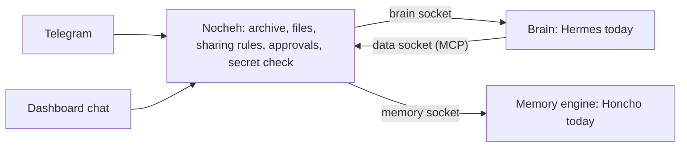
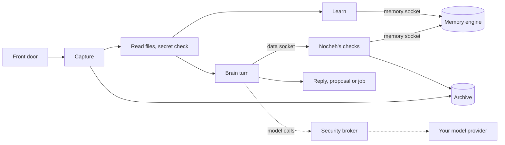

<p align="center">
  <picture>
    <source media="(prefers-color-scheme: dark)" srcset="docs/assets/logo/nocheh-logo-dark.svg" />
    
  </picture>
</p>

# Nocheh: a personal AI brain that you own

**Your data, your rules and your memory, owned by you.** Nocheh keeps what you and the people around you say in an archive you own, decides who may see and do what, and turns it into memory and answers. Nocheh is the part that stays. The engine that remembers and the brain that reasons each plug into it through a socket of their own.

## Why Nocheh

Today's AI assistants are rented brains. What they learn about you lives inside one app, one model and one company's memory, and switching tools means starting over.

Nocheh turns that around. Your source data stays in Nocheh, in a portable format, and memory is built from it and can be rebuilt from it. Nocheh also keeps the rules: who may see what, what may be shared and what needs your approval. The long-term memory engine (Honcho today) plugs in through the memory socket: swap it, and your data, your rules and your history stay where they are. The brain (Hermes today) reaches your data through Nocheh's tools, and Nocheh runs every turn through the brain socket. Replacing Hermes still needs the helpers and the Telegram connection it hosts to move into Nocheh first.

## The design

Nocheh is the permanent part. Everything else connects to it through a socket: a fixed connection point that any part of the right kind can plug into.



| Part | What it does | Today | Status |
| --- | --- | --- | --- |
| Nocheh | Keeps the archive, files, tasks, sharing rules, approvals and the secret check, and runs the dashboard | Nocheh | Permanent |
| Data socket | The brain reads the archive, memory, tasks and Notion, and asks to act, through Nocheh's tools served over MCP. Every call passes the same checks, so a chat gets only what it may see | Nocheh's `/mcp`, 18 tools | Live |
| Memory socket | Nocheh feeds long-term memory and asks it questions. The brain never talks to the engine | Honcho | Live |
| Brain socket | Nocheh starts, follows and cancels each turn on the brain that is plugged in, one brain at a time, and reaches the brain's own settings, role and skills, notes and schedules only through it. A page for a feature the brain lacks says so | Hermes | Live |
| Front doors | Where you talk to Nocheh | Telegram, still connected through Hermes for now, and Chat in the dashboard, which opens Hermes's own chat page for now | Moving Telegram into Nocheh is in progress |

Hermes still does more than reason. It also reads files and voice notes, makes the secret check's model call, holds the model provider keys and runs schedules. These move into Nocheh step by step; see [What's next](#whats-next). Each chat's role, skills and notes are kept in its Hermes profile, and Nocheh reaches them through the brain socket.

## What Nocheh does for you

- **Owns the source.** Every message, edit, reaction and file it sees is saved as an original, with where it came from, before any AI work starts. A slow or broken model never loses anything. Your messages and files are always kept. In **Settings › Privacy & data** you choose how long Nocheh keeps its own work records, such as work history.
- **Reads what you send.** Documents and photos are read into text and recordings are transcribed, live or imported, so you can search and ask about them. The text is checked for secrets like anything typed, and the original is kept.
- **Remembers people and projects.** Long-term memory (Honcho today) learns facts about people and projects, and each chat keeps its own assistant notes in Hermes. Who said something, and whether it was said, reported or inferred, stays attached.
- **Understands context.** It learns how a group works, like a ✅ reaction meaning "done", and follows the state of tasks and commitments even when it doesn't reply. You can inspect and correct what it learned.
- **Keeps your tasks.** Say "remind me to renew the domain on Friday" in your private chat, or use the **Tasks** page. Your personal list and each project's list stay apart, with due dates, repeats, reminders, a board view and your own columns. A project's chats see only that project's list.
- **Organizes knowledge.** With your permission it groups conversations into projects. In **Memory** you can look through people, projects and facts, and fix any of them.
- **Keeps audiences apart.** A group recalls only its own conversations, plus what a sharing rule lets in: facts you approve, or, when you tick **Chats in this project share what they know** on a project, what that project's other chats know. Your private chat can use everything.
- **Masks secrets.** A secret check finds passwords, keys and tokens and masks them before the assistant, memory or search ever sees them. You can review and edit every masked copy.
- **Asks before it acts.** Sending a message to another chat or running a shell, browser or MCP tool is proposed first, as a card with Approve and Reject. Decide with one tap in Telegram, or in the Inbox of the dashboard or the mini app. On a card you can also allow a site or a command in that chat for a while, and revoke it later in **Inbox › Allowed actions**. A big background job gets the same card in Telegram, with its estimated cost. With **Do what I ask** in **Settings › Assistant**, messages and tools you ask for in your private chat run without a separate yes.
- **Lets you pick its tools per chat.** Turn **Commands**, **Web pages** and **Outside tools** on or off for every chat in **Settings › Assistant**, or for one chat or topic on its page in **Chats**. Nocheh checks these switches itself, whichever brain asks.
- **Forgets on request.** Hide any message from the assistant and Nocheh stops using it, including in what it learned. You can hide its replies to that message too. The original stays in your archive, and Undo hiding brings it back.
- **Meets you where you talk.** Today that is Telegram, privately and in the groups you pick, with the people you allow there, and **Chat** in the dashboard. By default it answers in a group only when called: a reply to it, an @mention, or a message that starts with one of its names. It quietly saves everything else, and when called it also sees what was just said. Your private chat is yours alone: anyone else who writes to Nocheh privately gets one short fixed reply a day and never reaches a model. An optional Telegram mini app puts Home, Inbox, Tasks and Health on your phone.
- **Works on your own machines.** Add a VM or another machine you run in **Settings › Machines**, then ask for work there in chat. One plan card in your private chat covers the whole job. Nocheh keeps the machine's key, and the assistant never sees it.
- **Tells you when something breaks.** Your private chat gets a short notice about each new problem, such as failed work or a model that refused, with an **Open** button, plus **Retry failed** when failed work can run again. Turn notices off in **Settings › Telegram**.
- **A role and skills per project and chat.** Set the role and skills for every chat in **Settings › Assistant**, then give a project (in **Memory › Projects**) or a single chat (in **Chats**) its own. A chat's own role replaces its project's, which replaces the one for every chat. Skills add up. Only you can change them; the assistant can only update its notes.
- **Your models, your keys.** Use Anthropic, OpenAI or your own gateway (any OpenAI-compatible HTTPS address, with or without `/v1`). Pick one main model, or a different one for replies, memory, the secret check and images. Memory search and voice notes have their own choice. Keys stay on the server, replies on Anthropic use its prompt cache, and the Usage page shows what each part costs and how fast it answers.
- **Works with Notion.** Connect it and turn on **Use Notion** in **Settings › Connections**, and Nocheh can search, read and change your Notion from your private chat and from background jobs you approve there. By default reads run and changes ask you first, and groups never reach it. Notion counts as an outside tool, so **Outside tools** must be on for that chat.
- **Instructions you can edit.** In **Settings › Assistant** you can edit Nocheh's instructions to models and the fixed texts it sends, such as approval cards, reminders, problem notices and the reply to strangers. Each one can be reset to its default.
- **Yours to take with you.** Import chat history (Telegram Desktop exports today). Export your archive, memory and your own work, such as tasks, sharing rules and settings, in a portable format. Back up or restore the whole installation. Backups run on their own every day, and encrypted copies can go to storage you choose, off this machine.

## Quick start

You need Docker with Compose, Git, Node 26 and Python 3, a model provider key, and an OpenAI API key (or a gateway that offers the same models) for memory search and voice notes. To talk to Nocheh through Telegram, you also need a bot token from [BotFather](https://t.me/BotFather).

1. Install and create your local settings. `init` writes an ignored `.env` with generated internal passwords:

   ```bash
   npm ci
   ./bin/nocheh init
   ```

2. Start Nocheh. `up` builds it and runs it in the background:

   ```bash
   ./bin/nocheh up
   ```

3. Open the dashboard at <http://127.0.0.1:8783/> and create your Nocheh password. The same password signs you in to the Telegram mini app.
4. In **Settings › Models**, add a provider and choose the main model. Until then, replies and memory wait. If your main provider is not OpenAI, also add OpenAI, or a gateway with the same models, for **Memory search** and **Voice notes**.
5. Connect a chat. For Telegram, open **Settings › Telegram**, paste the bot token and save. Send your bot a private message, then press **Find my ID** and choose your account. Turn Telegram on and save. Home shows a **Get started** checklist of what is still missing.
6. Say hello in your private chat, or open **Chat** in the dashboard. To bring Nocheh into a group, add it there, then pick the group and who may talk to it in **Chats**.

Full setup: [Telegram and the mini app](docs/telegram.md), [model providers](docs/provider.md) and [operations](docs/deploy.md).

## Use it

- **Ask what you know.** "What did Sara say about the launch?" or "Sum up last week in the design group." Nocheh answers from your archive and memory, within what that chat is allowed to see. It can read a whole chat in order, or just between two dates. In chats that long-term memory has learned from, it also finds messages by meaning.
- **Let it follow along.** Leave it in a group and let people talk. Later, ask "What's still open in the design group?" and it answers from what it followed.
- **Ask it to act.** By default, "Tell the design group the meeting moved to 4" becomes a proposal you approve before anything is sent.
- **Hand it big work.** Ask for something too big for one reply, like "read the whole design chat and list every decision", and Nocheh offers a background job with its estimated time and cost. Once it is approved, the job runs on its own and sends its report to that chat. Watch or stop it in **System › Background work**, or stop it with Stop on its card. A job you ask for in your private chat can also run commands and Python in a sealed box with no internet and no keys, and read a copy of a GitHub repository you make in **Settings › Connections**; turn that off with **Sealed box for jobs** in **Settings › Assistant**.
- **Put it to work on a machine.** Ask from your private chat or a project's group, like "set up the demo project on build-vm". Nocheh sends one plan card to your private chat with the machine, the steps, the time and the cost. Once you approve it, the job works on that machine over SSH for up to 50 minutes. **System › Machine log** lists every command it ran, and Stop ends every program its login runs there. Give Nocheh a login of its own on the machine, not the one you use yourself.
- **Bring in your history.** Import old chats in **Messages › Import**. Before you start, it shows what checking and learning will cost, and you choose whether long-term memory may learn from them. Every message is saved, read and checked for secrets, and your private chat gets a message when the import is ready to ask about.
- **Look inside its head.** The dashboard shows what it knows and why. **Home** shows status, **Chat** talks to the assistant in your browser, **Inbox** shows what waits on you, and **Tasks** your task lists. **Chats** shows who can see what and which tools each chat may use, **Messages** every original and your imports, and **Memory** people, projects, facts, notes and which memory engine is plugged in. **Usage** shows cost and speed, **System** health, background work, the machine log and backups, and **Settings** models, Telegram, connections, machines and every instruction.
- **Correct it.** Fix a fact, rename a person, hide a message or undo an organization change. Nocheh rebuilds the affected memory from what remains.

## Run it

```bash
./bin/nocheh status                  # each service and its state
./bin/nocheh diagnose                # service health, the Telegram connection and stuck replies
./bin/nocheh backup                  # back up the archive, memory and settings now
./bin/nocheh export --output DIR     # write the portable package of your data
./bin/nocheh down                    # stop everything; your data stays
./bin/nocheh up                      # start again in the background
```

Lost the machine? On a new one, `./bin/nocheh offsite fetch --output DIR` downloads the newest off-site copy with your storage settings and opens it with your passphrase. `./bin/nocheh restore` then starts it as a new, switched-off installation for you to check. See [backups and restore](docs/deploy.md).

## How it works

Every message goes through the same steps. Capture keeps working even when everything else is down, and the rest runs as durable [Inngest](https://www.inngest.com) workflows with retries and history:

1. **Capture.** A front door hands each message to Nocheh, which saves the original before anything else. Telegram's door still runs inside Hermes today, and writes each update to a durable spool first.
2. **Prepare.** Documents, voice notes and photos are read into text, and the secret check makes a masked copy of all of it.
3. **Learn.** In the background, the memory engine learns about people and projects through the memory socket, Hermes updates each chat's notes, and Nocheh learns conventions and the state of tasks, whether or not a reply is needed. Imported history is learned by long-term memory only.
4. **Reason.** When a message needs an answer, Nocheh starts an isolated brain turn with a short-lived pass for that chat. The brain asks for what it needs through the data socket: the archive, memory, tasks or Notion. Nocheh checks every call against that chat's audience, sharing rules and tool switches, and answers with masked copies. The turn's model calls leave only through the security broker, so the turn never holds your keys. A request too big for one reply becomes a background job: one isolated run of up to 50 minutes that starts once approved.
5. **Act.** Messages to other chats, tools, background jobs and machine jobs follow your approval rules, and most wait for a yes from you or the person who asked. Every proposal, approval and result is recorded.



## Under the hood

Nocheh is TypeScript services, a React dashboard and mini app, and Python for its Hermes integration and a few helper services, all in one Docker Compose project.

- **Front doors.** Sources are stored in a platform-independent model (platform, kind, ID, relationships), so new chat platforms such as Slack or Discord fit without changing existing data. Telegram is the first front door.
- **Three databases.** `nocheh_archive` keeps original messages and file records and is never rewritten; file bytes are saved on disk beside it, named by their checksum. `nocheh_derived` keeps masked copies and everything generated. `nocheh_control` keeps settings, access rules, tool switches, approvals and jobs. Hermes, Honcho and Inngest keep their own stores.
- **Capture first.** Incoming messages land in a durable spool before they are acknowledged, then commit once. Restarts, retries and database outages don't drop or duplicate messages.
- **Workflows.** Inngest runs every reply, learning step, import and background job as a durable workflow with retries, waits and full history.
- **Brain.** [Hermes](https://github.com/NousResearch/hermes-agent) is the brain today. It runs each reply in an isolated turn, and each turn's pass names the brain it is for. Nocheh reaches it only through the brain socket, one `Brain` interface for turns and the brain's own settings, role and skills, notes and schedules. A missing feature answers `brain_capability_unavailable`. See [ADR-0234](docs/adr/0234-brain-socket.md). Hermes also still owns the Telegram connection, sessions, schedules, the role and skills of each chat and project, and each chat's notes, and its own tools read documents, transcribe voice notes and read images. The archive stays portable across brains.
- **Data socket.** Nocheh serves its data tools at its own `/mcp` endpoint, as the MCP server `nocheh`. Only a turn's own pass reaches it. Each of the 18 tools calls an existing Nocheh route with the turn's pass, so every audience, sharing, secret and approval check stays inside Nocheh. A refused or failed call comes back as a normal answer with an error code, such as `tool_disabled_by_owner`, not as an MCP error. The tools are plain MCP, so another brain with an MCP client could use them once it is plugged into the brain socket, which gives each of its turns a pass. A long memory recall in a background job can take up to ten minutes. See [ADR-0233](docs/adr/0233-data-tools-over-mcp.md).
- **Memory socket.** One `MemoryEngine` interface covers feeding memory, start-of-turn context, recall, search, corrections and deletions. [Honcho](https://github.com/plastic-labs/honcho) is the only engine today, using its own model of people and sessions, and its model calls go through a metered gateway that records their cost. Nocheh keeps the receipts, sessions, sharing rules and deletion bookkeeping. A different engine starts a new, empty memory space, and you choose whether it learns the archive again. See [ADR-0232](docs/adr/0232-memory-engine-socket.md).
- **Machines.** The `nocheh-machines` service alone holds each machine's SSH key; it has no database login and no Docker socket. A job's commands reach it only through the broker and Nocheh's checks, and the log keeps each command and a fingerprint of its output, never the output itself. Keys are not backed up. See [ADR-0231](docs/adr/0231-owner-approved-jobs-work-on-the-owners-machines-over-ssh.md).
- **Isolation.** Brain turns run in containers with one profile and scoped access: no provider keys, no Docker socket and no unrestricted internet. Approved shell work runs in disposable containers with no network.
- **Approvals.** Every external effect records its proposal, approval, start and result separately. An uncertain send is never repeated automatically.
- **Sign-in.** One Nocheh password signs in to the dashboard and the optional Telegram mini app. The mini app is a small separate service with no credentials of its own, and it reaches only a short list of owner pages.

Service map: [docs/services.md](docs/services.md).

## Good to know

- Nocheh answers only while its services are running. Telegram holds new messages for up to 24 hours, so short breaks lose nothing there.
- Dependable answers come before speed. A reply usually takes around half a minute, a bit longer when it first reads a new file, photo or voice note. While Nocheh works on it, Telegram shows "typing…" and the bot puts 👀 on the message it answers, then 👍 when it answered or 👎 when it failed.
- Photos are read by the **Images** model, which is your main model unless you pick another. Voice notes, audio files and round video notes are transcribed by the **Voice notes** model, OpenAI by default. Both are in **Settings › Models**. Recordings saved before you add a key are transcribed once you do. Stickers, animations and other videos are kept as originals only.
- Nocheh backs up the archive, memory and settings every day and keeps the newest seven automatic copies by default. Change the schedule in **Settings › Privacy & data**. Backups stay on this machine unless you turn on **Off-site copies** there: each new backup is then encrypted with your passphrase and sent to S3-compatible storage you choose. Keep the passphrase somewhere else, because without it no copy can be opened. Machine keys are left out of backups, so after a restore you add each machine again.
- No local models. Replies, learning, the secret check, images, memory search and voice notes all run on model providers you pay.
- Nocheh is in development and not released yet. Live release checks are tracked in [docs/mvp-acceptance-status.md](docs/mvp-acceptance-status.md).

## What's next

- **Telegram moves into Nocheh** (in progress). A Nocheh service becomes the only bot, so the brain no longer holds the bot token.
- **More out of Hermes.** The secret check's model call, file and voice reading, provider keys and schedules move into Nocheh. Then another brain, such as Claude Code, can replace Hermes.
- **Later.** Another memory engine, such as mem0, behind the memory socket. Slack as another front door. Nocheh's own chat page that talks to whichever brain is plugged in. Several brains at once is a long-term idea, not planned work.

## Develop

```bash
npm ci
./bin/nocheh test        # PostgreSQL, TypeScript and Python integration tests
make dev                 # run from your checkout and reload on code changes
make dev-status          # is the development stack running?
make dev-stop            # stop it; your data stays
make dev-build           # rebuild after dependency or Dockerfile changes
```

`make dev` runs the code in your current checkout with the same settings and data as `up`. It starts only while Telegram is on and the background stack is stopped, so finish the Quick start, run `./bin/nocheh down`, then start `make dev`. See [Start and develop](docs/deploy.md#start-and-develop).

The sockets live in `src/brain` (brains), `src/mcp` (data tools) and `src/memory` (memory engines). A new brain is one file that implements `Brain`, plus one line in `src/brain/brains.ts`. A new memory engine is one file that implements `MemoryEngine`, plus one line in `src/memory/engines.ts`.

[SPECS.md](SPECS.md) defines what Nocheh must be and do, [TASK.md](TASK.md) tracks status and open checks, and [AGENTS.md](AGENTS.md) holds the working rules. Decisions live in the [ADRs](docs/adr/README.md), and [docs/repository-layout.md](docs/repository-layout.md) explains every folder. Agent skills for [admin inspection](.agent/skills/nocheh-admin-cli/SKILL.md), [deployment](.agent/skills/nocheh-deploy/SKILL.md) and [Graphify](.agent/skills/graphify/SKILL.md) live in `.agent/skills`. Code from before Hermes is kept on the `archive/pre-hermes-nocheh` branch.

## License

MIT. See [LICENSE](LICENSE).

Built by [PlaygrndLabs](https://github.com/PlaygrndLabs).
