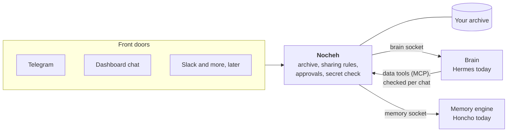
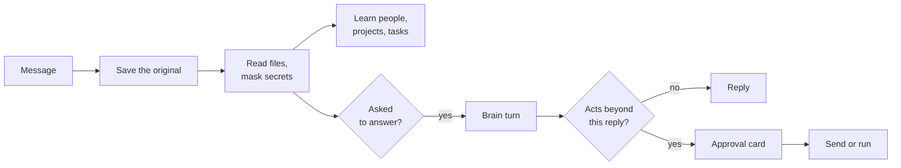
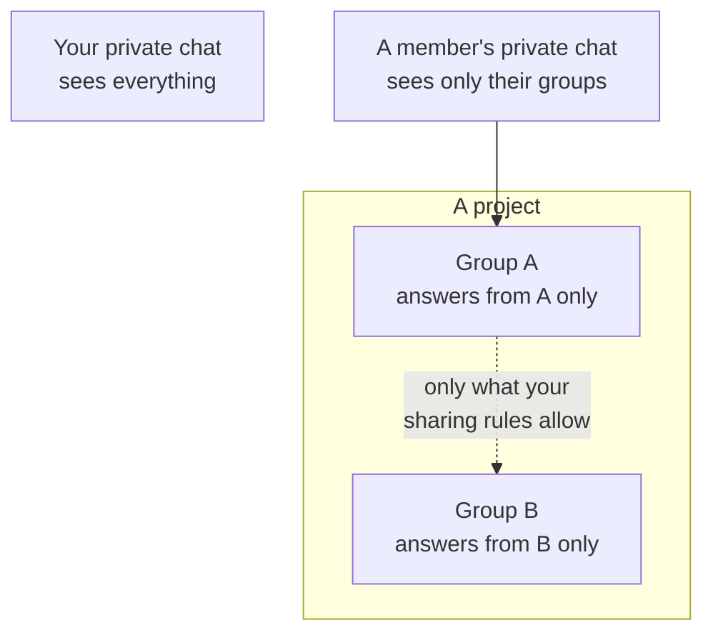

<p align="center">
  <picture>
    <source media="(prefers-color-scheme: dark)" srcset="docs/assets/logo/nocheh-logo-dark.svg" />
    
  </picture>
</p>

# Nocheh: a personal AI brain that you own

Nocheh keeps your chats and files in an archive you own, decides who may see what, and turns it into memory and answers. The brain and the memory engine plug in through sockets. Swap them, and your data and rules stay.

## How the parts connect



## What happens to a message



## Who sees what



## Quick start

You need Docker with Compose, Git, Node 26, Python 3, a model provider key and an OpenAI key (memory search and voice notes).

```bash
npm ci
./bin/nocheh init   # writes your .env
./bin/nocheh up     # builds and starts Nocheh
```

Open <http://127.0.0.1:8783/>, create your password, then follow the **Get started** checklist on Home: add a model in **Settings › Models** and connect a chat in **Settings › Telegram**.

## Learn more

| Topic | Read |
| --- | --- |
| Every feature and how to use it | [docs/features.md](docs/features.md) |
| Design, sockets and message steps | [docs/architecture.md](docs/architecture.md) |
| Telegram and the mini app | [docs/telegram.md](docs/telegram.md) |
| Model providers | [docs/provider.md](docs/provider.md) |
| Run, workspaces, backups, develop | [docs/deploy.md](docs/deploy.md) |
| Services | [docs/services.md](docs/services.md) |
| Decisions | [docs/adr/README.md](docs/adr/README.md) |
| Specs, status, working rules | [SPECS.md](SPECS.md), [TASK.md](TASK.md), [AGENTS.md](AGENTS.md) |

Nocheh is in development and not released yet. MIT license, see [LICENSE](LICENSE). Built by [PlaygrndLabs](https://github.com/PlaygrndLabs).
