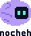
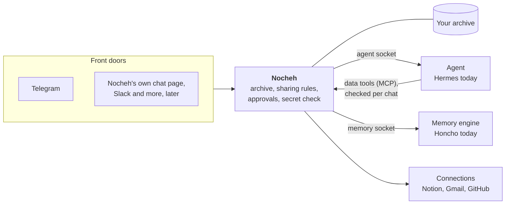
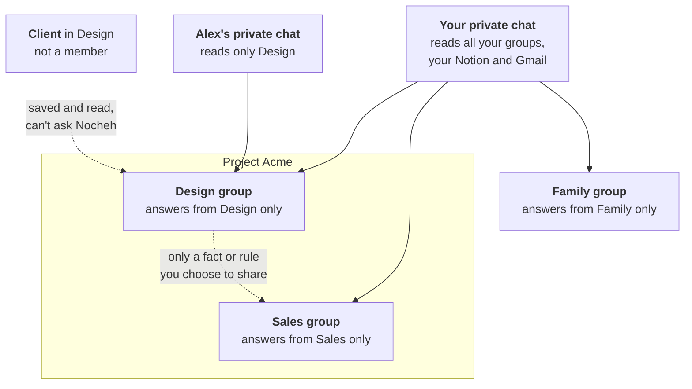

<p align="center">
  <picture>
    <source media="(prefers-color-scheme: dark)" srcset="docs/assets/logo/nocheh-logo-dark.svg" />
    
  </picture>
</p>

# Nocheh: a personal AI brain that you own

**Your data, your rules and your memory, owned by you.** Nocheh keeps what you and the people around you say in an archive you own. It decides who may see and do what, and turns it into memory and answers.

Today's AI assistants are rented brains: what they learn lives inside one app and one company, and switching means starting over. In Nocheh the agent and the memory engine plug in through sockets. Swap them, and your data, your rules and your history stay.

## How the parts connect



| Part | Job | Today |
| --- | --- | --- |
| Nocheh | Keeps the archive, files, tasks, sharing rules and approvals. Runs the dashboard | Permanent |
| Agent | Reasons and writes each reply. Reads your data only through Nocheh's tools | Hermes |
| Memory engine | Learns people and projects, finds things by meaning | Honcho |
| Front doors | Where you talk to Nocheh | Telegram |

## What it does

- **Keeps every original.** Messages, edits, reactions and files are saved before any AI work starts. Nothing is lost when a model is slow or down.
- **Reads what you send.** Documents and photos become text, voice notes are transcribed.
- **Remembers.** It learns people, projects and how each group works, like ✅ meaning "done".
- **Keeps your tasks.** "Remind me to renew the domain on Friday" becomes a task with a reminder.
- **Keeps audiences apart.** Each chat sees only what it may see. See [Who sees what](#who-sees-what).
- **Masks secrets.** Passwords, keys and tokens are masked before any model, memory or search sees them.
- **Asks before it acts.** Sending to another chat or running a tool waits for your Approve on a card.
- **Handles big work.** A job too big for one reply runs in the background after you approve its cost.
- **Works on your machines.** It runs approved jobs on your own VM or server over SSH.
- **Forgets on request.** Hide a message and Nocheh stops using it, also in what it learned.
- **Stays yours.** Import old chats, export everything in a portable format, and back up every day.

Full list with examples: [docs/features.md](docs/features.md).

## What happens to a message


In a group, Nocheh answers only when called: a reply to it, an @mention or its name. It quietly saves everything else.

## Who sees what

An example. You run the project **Acme** with two groups, **Design** and **Sales**, and you also have a **Family** group. Alex is a member who joined Design only. A client who is not a member also writes in Design.



Who asks "What did the client decide?":

| Asked by, where | Answer uses |
| --- | --- |
| You, in your private chat | Everything: Design, Sales, Family, Notion, Gmail |
| You, in Design | Design only, even though you can see more |
| You, tap **Answer privately** under that answer | All Acme groups, sent to your private chat |
| Alex, in Design or in Alex's private chat | Design only, the one group Alex joined |
| A member in Sales | Sales, plus the facts you shared from Design |
| The client | No answer: the message is saved, but only members can ask |
| A stranger writing to Nocheh privately | One short fixed reply a day, never a model |

## Quick start

You need Docker with Compose, Git, Node 26, Python 3, a model provider key and an OpenAI key (memory search and voice notes). For Telegram, also a bot token from [BotFather](https://t.me/BotFather).

```bash
npm ci
./bin/nocheh init   # writes your .env with generated passwords
./bin/nocheh up     # builds and starts Nocheh in the background
```

1. Open <http://127.0.0.1:8783/> and create your password. It also signs you in to the Telegram mini app.
2. In **Settings › Models**, add a provider and pick the main model.
3. In **Settings › Telegram**, paste the bot token, message your bot, press **Find my ID**, then turn Telegram on.
4. Say hello in your private chat. Add Nocheh to a group from your Telegram account, and add people on the **Members** page.

Home shows a **Get started** checklist of what is still missing. Details: [Telegram](docs/telegram.md), [model providers](docs/provider.md).

## Run it

```bash
./bin/nocheh status      # each service and its state
./bin/nocheh diagnose    # health, the Telegram connection and stuck replies
./bin/nocheh backup      # back up now (it also runs every day)
./bin/nocheh down        # stop; your data stays
```

Several workspaces, backups, restore and development: [docs/deploy.md](docs/deploy.md).

## Learn more

| Topic | Read |
| --- | --- |
| Every feature, with examples | [docs/features.md](docs/features.md) |
| Design, sockets and message steps | [docs/architecture.md](docs/architecture.md) |
| Services | [docs/services.md](docs/services.md) |
| Decisions | [docs/adr/README.md](docs/adr/README.md) |
| Specs, status, working rules | [SPECS.md](SPECS.md), [TASK.md](TASK.md), [AGENTS.md](AGENTS.md) |

Nocheh is in development and not released yet. MIT license, see [LICENSE](LICENSE). Built by [PlaygrndLabs](https://github.com/PlaygrndLabs).
