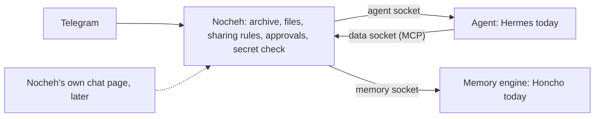
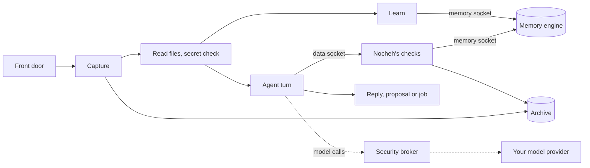

# How Nocheh works

The design in detail, moved from the README. Service list: [services.md](services.md). Operations: [deploy.md](deploy.md).

## Why Nocheh

Today's AI assistants are rented agents. What they learn about you lives inside one app, one model and one company's memory, and switching tools means starting over.

Nocheh turns that around. Your source data stays in Nocheh, in a portable format, and memory is built from it and can be rebuilt from it. Nocheh also keeps the rules: who may see what, what may be shared and what needs your approval. The long-term memory engine (Honcho today) plugs in through the memory socket: swap it, and your data, your rules and your history stay where they are. The agent (Hermes today) reaches your data through Nocheh's tools, and Nocheh runs every turn through the agent socket. Nocheh's own service is the Telegram bot, so the agent never holds the bot token. Replacing Hermes still needs the helper services it hosts, such as file and voice reading and the secret check's model call, to move into Nocheh first.

## The design

Nocheh is the permanent part. Everything else connects to it through a socket: a fixed connection point that any part of the right kind can plug into.

| Part | What it does | Today | Status |
| --- | --- | --- | --- |
| Nocheh | Keeps the archive, files, tasks, sharing rules, approvals and the secret check, and runs the dashboard | Nocheh | Permanent |
| Data socket | The agent reads the archive, memory, tasks and Notion, and asks to act, through Nocheh's tools served over MCP. Every call passes the same checks, so a chat gets only what it may see | Nocheh's `/mcp`, 18 tools | Live |
| Memory socket | Nocheh feeds long-term memory and asks it questions. The agent never talks to the engine | Honcho | Live |
| Agent socket | Nocheh starts, follows and cancels each turn on the agent that is plugged in, one agent at a time, and reaches the agent's own settings, role and skills, notes and schedules only through it. A page for a feature the agent lacks says so | Hermes | Live |
| Front doors | Where you talk to Nocheh | Telegram, through Nocheh's own bot service. The dashboard has no chat page until Nocheh has its own; Hermes's chat page is off ([ADR-0289](adr/0289-chat-page-off-and-hermes-reads-passes-without-the-master-key.md)) | Telegram live; Nocheh's own chat page is next |

Hermes still does more than reason. It also reads files and voice notes, makes the secret check's model call, holds the model provider keys and runs schedules. These move into Nocheh step by step; see [What's next](#whats-next). Each chat's role, skills and notes are kept in its Hermes profile, and Nocheh reaches them through the agent socket.

## Message steps

Every message goes through the same steps. Capture keeps working even when everything else is down, and the rest runs as durable [Inngest](https://www.inngest.com) workflows with retries and history:

1. **Capture.** A front door hands each message to Nocheh, which saves the original before anything else. Telegram's door is Nocheh's own bot service, `nocheh-telegram`, which writes each update to a durable spool first.
2. **Prepare.** Documents, voice notes and photos are read into text, and the secret check makes a masked copy of all of it.
3. **Learn.** In the background, the memory engine learns about people and projects through the memory socket, Hermes updates each chat's notes, and Nocheh learns conventions and the state of tasks, whether or not a reply is needed. Imported history is learned by long-term memory only.
4. **Reason.** When a message needs an answer, Nocheh starts an isolated agent turn with a short-lived pass for that chat. The agent asks for what it needs through the data socket: the archive, memory, tasks or Notion. Nocheh checks every call against that chat's audience, sharing rules and tool switches, and answers with masked copies. The turn's model calls leave only through the security broker, so the turn never holds your keys. A request too big for one reply becomes a background job: one isolated run of up to 50 minutes that starts once approved.
5. **Act.** Messages to other chats, tools, background jobs and machine jobs follow your approval rules, and most wait for a yes from you or the person who asked. Every proposal, approval and result is recorded.

## Under the hood

Nocheh is TypeScript services, a React dashboard and mini app, and Python for its Hermes integration and a few helper services, all in one Docker Compose project.

- **Front doors.** Sources are stored in a platform-independent model (platform, kind, ID, relationships), so new chat platforms such as Slack or Discord fit without changing existing data. Telegram is the first front door, run by Nocheh's own `nocheh-telegram` service, which polls Telegram and sends every reply, card and notice. Nocheh decides whether a group message addresses the bot before any agent sees it.
- **Three databases.** `nocheh_archive` keeps original messages and file records and is never rewritten; file bytes are saved on disk beside it, named by their checksum. `nocheh_derived` keeps masked copies and everything generated. `nocheh_control` keeps settings, access rules, tool switches, approvals and jobs. Hermes, Honcho and Inngest keep their own stores.
- **Capture first.** Incoming messages land in a durable spool before they are acknowledged, then commit once. Restarts, retries and database outages don't drop or duplicate messages.
- **Workflows.** Inngest runs every reply, learning step, import and background job as a durable workflow with retries, waits and full history.
- **Agent.** [Hermes](https://github.com/NousResearch/hermes-agent) is the agent today. It runs each reply in an isolated turn, and each turn's pass names the agent it is for. Nocheh reaches it only through the agent socket, one `Agent` interface for turns and the agent's own settings, role and skills, notes and schedules. A missing feature answers `agent_capability_unavailable`. See [ADR-0234](adr/0234-brain-socket.md). The agent only writes replies: Nocheh's own bot shows typing and reactions and sends them ([ADR-0235](adr/0235-nocheh-owns-the-telegram-bot.md)). Hermes still owns sessions, schedules, the role and skills of each chat and project, and each chat's notes, and its own tools read documents, transcribe voice notes and read images. The archive stays portable across agents.
- **Data socket.** Nocheh serves its data tools at its own `/mcp` endpoint, as the MCP server `nocheh`. Only a turn's own pass reaches it. Each of the 18 tools calls an existing Nocheh route with the turn's pass, so every audience, sharing, secret and approval check stays inside Nocheh. A refused or failed call comes back as a normal answer with an error code, such as `tool_disabled_by_owner`, not as an MCP error. The tools are plain MCP, so another agent with an MCP client could use them once it is plugged into the agent socket, which gives each of its turns a pass. A long memory recall in a background job can take up to ten minutes. See [ADR-0233](adr/0233-data-tools-over-mcp.md).
- **Memory socket.** One `MemoryEngine` interface covers feeding memory, start-of-turn context, recall, search, corrections and deletions. [Honcho](https://github.com/plastic-labs/honcho) is the only engine today, using its own model of people and sessions, and its model calls go through a metered gateway that records their cost. Nocheh keeps the receipts, sessions, sharing rules and deletion bookkeeping. A different engine starts a new, empty memory space, and you choose whether it learns the archive again. See [ADR-0232](adr/0232-memory-engine-socket.md).
- **Machines.** The `nocheh-machines` service alone holds each machine's SSH key; it has no database login and no Docker socket. A job's commands reach it only through the broker and Nocheh's checks, and the log keeps each command and a fingerprint of its output, never the output itself. Keys are not backed up. See [ADR-0231](adr/0231-owner-approved-jobs-work-on-the-owners-machines-over-ssh.md).
- **Isolation.** Agent turns run in containers with one profile and scoped access: no provider keys, no Docker socket and no unrestricted internet. Approved shell work runs in disposable containers with no network.
- **Approvals.** Every external effect records its proposal, approval, start and result separately. An uncertain send is never repeated automatically.
- **Sign-in.** One Nocheh password signs in to the dashboard and the optional Telegram mini app. The mini app is a small separate service with no credentials of its own, and it reaches only a short list of owner pages.

Service map: [services.md](services.md).

## Add an agent or memory engine

The sockets live in `src/agent` (agents), `src/mcp` (data tools) and `src/memory` (memory engines). A new agent is one file that implements `Agent`, plus one line in `src/agent/agents.ts`. A new memory engine is one file that implements `MemoryEngine`, plus one line in `src/memory/engines.ts`.

## What's next

- **More out of Hermes.** The secret check's model call, file and voice reading, provider keys and schedules move into Nocheh. Then another agent, such as Claude Code, can replace Hermes.
- **Later.** Another memory engine, such as mem0, behind the memory socket. Slack as another front door. Nocheh's own chat page that talks to whichever agent is plugged in. Several agents at once is a long-term idea, not planned work.
