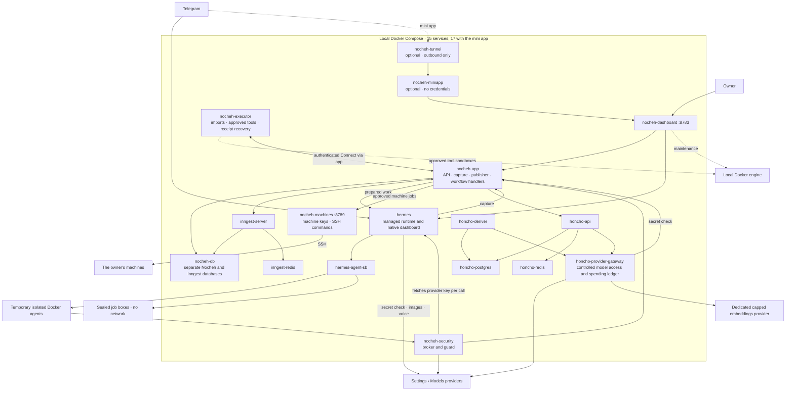

<deployment>

# Nocheh services

[ADR-0048](adr/0048-containerized-management.md) defines the container migration.
Docker administration access is explicitly owner-authorized.
[TASK.md](../TASK.md) records implementation and activation evidence.

<layout>

One Compose project contains 15 continuously running containers when Honcho is
enabled, 17 with the Telegram mini app, and one more with pgweb. In the original-only layout, database initialization
runs inside `nocheh-db` before it reports healthy. The legacy layout retains
its application startup initialization.
Temporary isolated agent containers are additional.

| Service | Tool and purpose | Location / expected state |
| --- | --- | --- |
| `nocheh-dashboard` | Owner dashboard, configuration, monitoring and recovery | Docker / running |
| `nocheh-executor` | Inngest executor workflows and independent receipt recovery | Docker / running |
| `nocheh-app` | API, source capture, durable event publisher and ordinary Inngest handlers | Docker / running |
| `nocheh-db` | Separate Nocheh and Inngest databases and roles | Docker / running |
| `nocheh-security` | Security broker, guard and exact authorization checks | Docker / running |
| `hermes` | The only Telegram poller and sender; managed Hermes runtime and native dashboard | Docker / running |
| `hermes-agent-sb` | Launch sealed turn containers and job boxes; only agent infrastructure container mounting the Docker socket | Docker / running |
| `nocheh-machines` | Run the commands of jobs the owner approved on the owner's machines over SSH; the only service holding their keys | Docker / running |
| `inngest-server` | Workflow scheduling, retries, waits and inspection UI | Docker / running |
| `inngest-redis` | Durable workflow queue and run state | Docker / running |
| `honcho-api` | Memory API | Docker / running when enabled |
| `honcho-deriver` | Honcho's internal background processing | Docker / running when enabled |
| `honcho-postgres` | Memory, vectors and derivation jobs | Docker / running when enabled |
| `honcho-redis` | Memory cache | Docker / running when enabled |
| `honcho-provider-gateway` | Controlled model access and embedding spending records | Docker / running when enabled |
| `nocheh-miniapp` | Telegram mini app (Home, Inbox, Tasks); holds no credentials | Docker / running when set up |
| `nocheh-tunnel` | Tunnel connector; reaches only the mini app | Docker / running when set up |
| `pgweb-archive` | Read-only database viewer | Docker / optional-stopped |
| `honcho-cli` | One-shot memory inspection | Docker / optional-stopped |

`./bin/nocheh status` and Monitoring show each service's tool, purpose,
location, observed state and expected state. The Honcho metrics probe establishes
process availability; memory backlog and receipt observations establish progress.
API, capture and Inngest connectivity are separate observations.

`nocheh-machines` listens on port 8789 inside the Compose network only. Only
`nocheh-app` and `nocheh-machines` get `NOCHEH_MACHINE_TOKEN`. Only
`nocheh-machines` uses the machines' keys in `data/local/machines/` and mounts that
folder on its own; the dashboard and executor see it only inside the whole state
folder they mount for backups and restarts, and leave it out of backups. It has no
Docker socket, database login or service token. It runs from the management
image on the default network, with `host.docker.internal` mapped to the host, and
reports unhealthy when `ssh` cannot run as `NOCHEH_UID`. A job's commands reach it
from its sealed turn through `nocheh-security` and `nocheh-app`. It caps a command's
output frames at 8 MiB, their headers included, and runs one cleanup at a time for
each machine, since a cleanup ends every program of the machine's login; see
[ADR-0231](adr/0231-owner-approved-jobs-work-on-the-owners-machines-over-ssh.md).

Nocheh runs no model provider service. Model calls leave through the security
broker (replies), `hermes` (the secret check, images and voice notes) and `honcho-provider-gateway` (memory and
embeddings) to the providers chosen in Settings › Models; see
[model providers](provider.md).

</layout>

<relationships>

Ordinary functions share one application and concurrency eight. Executor functions use
concurrency two. The application gives API/capture and workflow handlers separate
PostgreSQL pools, each capped at eight. SDK reconnection does not gate API startup.
Inngest Redis uses AOF, `appendfsync always` and `noeviction`.

Startup in the original-only layout: PostgreSQL and store provisioning →
application healthy → Inngest (also waits for Redis). Initialization preserves
existing data. Inngest retains its restricted database role and cannot connect to
the archive. See [ADR-0054](adr/0054-postgres-owned-store-bootstrap.md). The
legacy layout follows [ADR-0049](adr/0049-application-database-bootstrap.md).

</relationships>

<workflow>

Telegram → `hermes` spools the update → `nocheh-app` archives it and requests the
preparation, memory review and reply workflows → files read and secret-checked into masked
copies → sealed Hermes turn through `nocheh-security`, with exact approvals for actions → `hermes` sends the reply, which is
archived. Memory review writes the masked messages it may learn from to Honcho beside the reply, once preparation finishes.

Preparation is a prerequisite. Workflow events carry opaque references and approved
metadata; originals, transcripts, arguments and credentials remain protected.
Telegram reception, synchronous security, Hermes reasoning and Honcho's internal
PostgreSQL derivation queue stay with their respective tools.

</workflow>

<dashboards>

- Owner dashboard: <http://localhost:8783/>. Start with `./bin/nocheh dashboard`.
  It is independent of application and Inngest availability; it requires Docker.
- Hermes: <http://localhost:8783/hermes/nocheh>, through the owner session and the
  existing managed administration server. No separate frontend container or stock
  gateway/scheduler startup runs. Presentation preferences live in
  `data/local/admin/dashboard/home/`, separately from runtime profiles.
- Inngest inspection: <http://localhost:8783/inngest/runs>.
- Optional pgweb: <http://localhost:8782/>, after `./bin/nocheh db`.

React, React DOM, Three.js, GraphQL, pg, TypeScript and esbuild are libraries or
build tools, not additional production services. The management image contains Node 26.x, Python, and pinned Docker CLI tools.
It mounts installation paths at the same absolute locations for maintenance and
approved tool bind mounts. Docker-socket access for these two trusted services is explicitly owner-authorized.

</dashboards>
</deployment>
